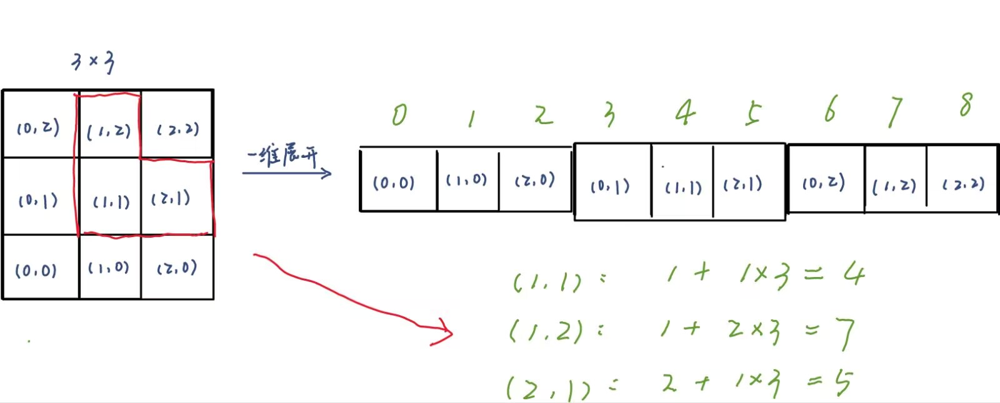
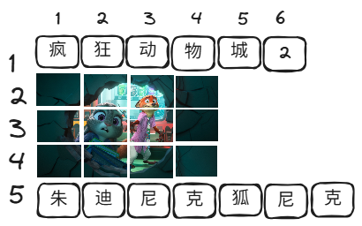
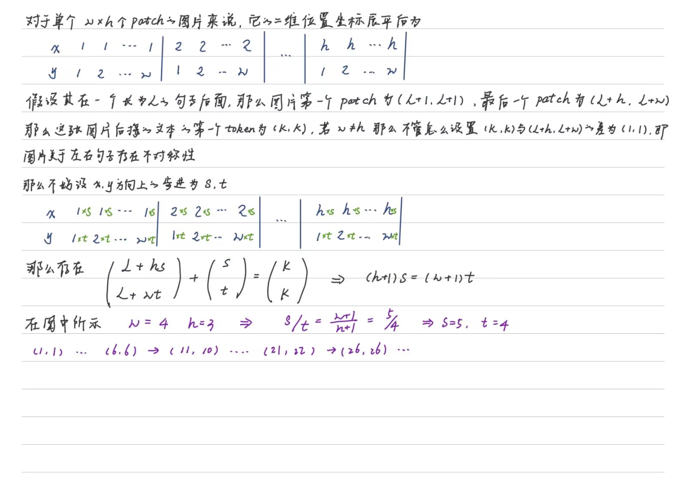
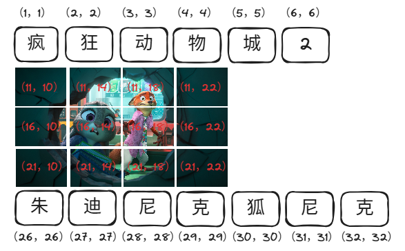

# 2DRoPE以及3DRope解读

## 2DRoPE

引用：*https://spaces.ac.cn/archives/10040*

### 对于图像来讲，为什么不将图像一维展平后进行处理呢？




如图所示，将3×3的图片展平后对于二维(x,y)坐标下的一维坐标变成了x+y×3，对于(1,1)坐标来说，它的相邻坐标(1,2)和(2,1)分别与它的一维坐标相差3和1，这显然是不合理的。

### 那么文字如何进行二维坐标赋予呢？

第一种情况，以图片为分隔符对文本进行分段，连续的文本都视为一行，图片则占据多行，那么排版后的图片和文本的如下图所示。



这种方法存在几个缺点

- 首先，对于文本输入来说，它无法退化为1DRoPE，而是变成了x始终固定的2DRoPE，这意味着它不能直接利用纯文本 LLM 的权重和结构。换句话说，纯文本 LLM 中学到的知识（如语言模式和语义理解）无法直接迁移到多模态模型中，因为模型的输入机制和位置编码方式发生了根本性的变化。
- 其次，以图片作为分割点的话，当图片比较多时，可能会让文本被分割得过于“支离破碎”，具体表现包括每一段文本的长度波动太大、本该连续的文本被强行换行等，这些都可能成为限制效果的瓶颈。

### 那么，让文字可以退化成1DRoPE是要解决的主要问题

首先，在前面已经提到过，Rx,y是Rx和Ry的分块对角组合，所以Rn,n是两个Rn的分块对角组合，而1DRoPE的R(d×d)n也是多个不同θ的Rn的分块对角组合，由此可见，只要我们从R(d×d)n选取不同的θ给x,y，那么Rn,n就可以看成是1DRoPE（即R(d×d)n）的一部分。这样看来，要想2DRoPE能退化为1DRoPE，那么文本的位置应该采取(n,n)的形式，而不是像上一节那样用其他方式指定一个行号。



具体例子如图所示：



### 源代码

打断点

```python
import pdb;pdb.set_trace()
```

### apply_rotary_pos_emb_vision

```python
def apply_rotary_pos_emb_vision(
    q: torch.Tensor, k: torch.Tensor, cos: torch.Tensor, sin: torch.Tensor
) -> tuple[torch.Tensor, torch.Tensor]:
    # 保存查询和键张量的原始数据类型，以便在处理完成后将结果转换回原始类型
    orig_q_dtype = q.dtype
    orig_k_dtype = k.dtype
    q, k = q.float(), k.float()
    cos, sin = cos.unsqueeze(-2).float(), sin.unsqueeze(-2).float()
    q_embed = (q * cos) + (rotate_half(q) * sin)
    k_embed = (k * cos) + (rotate_half(k) * sin)
    q_embed = q_embed.to(orig_q_dtype)
    k_embed = k_embed.to(orig_k_dtype)
    return q_embed, k_embed
```

**问：为什么倒数第二个维度（`-2`）添加新维度**

假设`q, k`的维度为`[B, N, H]`，`cos`和`sin`的维度为`[N, H]`，在倒数第二维度添加维度后变为`[N, 1, H]`，在 PyTorch 中，广播机制要求张量在某些维度上具有相同的形状，或者某些维度的大小为 1。具体来说：

- 如果两个张量在某个维度上的大小相同，它们可以广播。
- 如果一个张量在某个维度上的大小为 1，而另一个张量在该维度上的大小大于 1，那么较小的张量会自动扩展以匹配较大的张量

所以，在广播机制下，`cos` 和 `sin` 的形状 `[N, 1, H]` 可以在第二个维度（`N`）上广播，从而匹配查询和键张量的形状 `[B, N, H]`

### Qwen2_5_VisionRotaryEmbedding

```python
class Qwen2_5_VisionRotaryEmbedding(nn.Module):
    def __init__(self, dim: int, theta: float = 10000.0) -> None:
        super().__init__()
        inv_freq = 1.0 / (theta ** (torch.arange(0, dim, 2, dtype=torch.float) / dim))
        # 注册theta数据
        self.register_buffer("inv_freq", inv_freq, persistent=False)

    def forward(self, seqlen: int) -> torch.Tensor:
        seq = torch.arange(seqlen, device=self.inv_freq.device, dtype=self.inv_freq.dtype)
        freqs = torch.outer(seq, self.inv_freq)
        return freqs
```

计算频率

### rot_pos_emb

```python
def rot_pos_emb(self, grid_thw):
    # 初始化一个空格列表，用于存储每个网格的位置ID
    pos_ids = []
    for t, h, w in grid_thw:
        hpos_ids = torch.arange(h).unsqueeze(1).expand(-1, w) # 维度变为[h,w]
        hpos_ids = hpos_ids.reshape(
            h // self.spatial_merge_size,
            self.spatial_merge_size,
            w // self.spatial_merge_size,
            self.spatial_merge_size,
        )
        hpos_ids = hpos_ids.permute(0, 2, 1, 3)
        hpos_ids = hpos_ids.flatten()

        wpos_ids = torch.arange(w).unsqueeze(0).expand(h, -1)
        wpos_ids = wpos_ids.reshape(
            h // self.spatial_merge_size,
            self.spatial_merge_size,
            w // self.spatial_merge_size,
            self.spatial_merge_size,
        )
        wpos_ids = wpos_ids.permute(0, 2, 1, 3)
        wpos_ids = wpos_ids.flatten()
        pos_ids.append(torch.stack([hpos_ids, wpos_ids], dim=-1).repeat(t, 1))
    pos_ids = torch.cat(pos_ids, dim=0)
    max_grid_size = grid_thw[:, 1:].max()
    rotary_pos_emb_full = self.rotary_pos_emb(max_grid_size)
    rotary_pos_emb = rotary_pos_emb_full[pos_ids].flatten(1)
    return rotary_pos_emb
```

